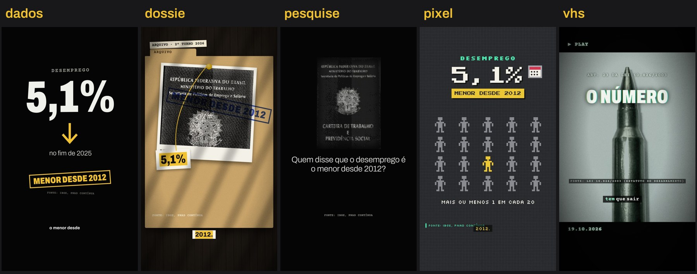

# motion-eleicao

Uma skill gratuita pro **Claude Code** e o **Codex** que faz vídeo motion 9:16 sobre a eleição (Reels, TikTok, Shorts)
a partir de uma pauta. Você escreve a pauta. A IA confere os fatos e escreve o roteiro. O resto sai sozinho, no seu
computador: narração, imagens livres, animação feita em código, trilha, legenda e render.

- **5 estilos:** dossiê, VHS, pesquise, dados e pixel. E dá pra ensinar estilos novos mandando uma referência.
- **17 pautas** com os fatos já checados e as fontes.
- **Fonte em todo fato**, na tela. A skill recusa roteiro com número sem fonte e acusação sem condenação.
- **Voz grátis:** uma voz padrão, ou a sua, clonada no seu computador.
- **Nenhuma fala cortada:** antes do render a skill ouve cada fala e confere que está inteira.

**[Veja como funciona, com prints de tudo](https://o-que-ta-em-jogo.pages.dev/skill/)**

**[Baixar a skill](https://o-que-ta-em-jogo.pages.dev/skill/baixar)** · **[Só quero os 9 vídeos prontos (Drive)](https://o-que-ta-em-jogo.pages.dev/skill/videos)**

Não funciona no chat do site do Claude (claude.ai): lá a IA não consegue rodar o motor de vídeo no seu computador.

---

## 1. Instalar (uma vez só)

**Jeito mais fácil:** abra o Claude Code (ou o Codex) numa pasta qualquer e escreva:

> Instala pra mim a skill motion-eleicao seguindo esta página: https://o-que-ta-em-jogo.pages.dev/skill/

A IA baixa este repositório e roda o instalador. Se aparecer pedido de senha do computador, ela vai pedir pra você
digitar no Terminal (ela não pode digitar senha por você).

**Baixando o zip:** [baixe aqui](https://o-que-ta-em-jogo.pages.dev/skill/baixar) (é o zip deste repositório), descompacte, abra o Claude Code dentro da pasta e
escreva "instala essa skill".

**Jeito manual:** depois de descompactar,
- **Mac ou Linux:** no Terminal, rode `bash instalar.sh` dentro da pasta.
- **Windows:** clique com o botão direito em `instalar.ps1` e escolha "Executar com o PowerShell"
  (ou rode `powershell -ExecutionPolicy Bypass -File instalar.ps1`).

O instalador confere e instala o que faltar: Python, Node.js, ffmpeg, o HyperFrames (o motor que monta o vídeo), as
vozes grátis e o conferidor de falas, e copia a skill pro Claude Code e pro Codex. Leva de 5 a 20 minutos e precisa de
uns 2 GB livres (mais 5 GB se for clonar a sua voz).

## 2. Sua voz (opcional)

A narração já sai com uma voz padrão, sem você fazer nada: com o VoiceStudio instalado, o **Narrador Grave** (uma voz
sintética gerada pelo OmniVoice, que não é de nenhuma pessoa); sem ele, a voz neural Kokoro; e, por último, a voz do
sistema. Já dá pra postar. **Mas recomendamos gravar a sua própria voz**: fica mais natural e passa mais confiança pra quem
assiste, porque é você falando.

Pra narrar com a sua voz, de graça e sem mandar nada pra internet, é só pedir pra IA "quero usar a minha voz":
ela te conduz passo a passo (instalar, gravar um texto de 30 segundos, clonar, ouvir um teste e salvar). Se preferir
fazer na mão:

1. Instale o VoiceStudio (o instalador pergunta; ou rode na mão):
   - Mac e Linux: `curl -fsSL https://voicestudio.sh/install | sh`
   - Windows (PowerShell): `irm https://voicestudio.sh/install | iex`
   - Mac Intel: o VoiceStudio só funciona com backend remoto. Se for o seu caso, fique com a voz do sistema.
2. Grave uns 30 segundos de você lendo o texto que a IA te passa (ou qualquer texto), num lugar silencioso,
   no seu tom normal, com o celular a um palmo da boca.
3. Mande a gravação pra IA: ela cria a voz no VoiceStudio, gera uma frase de teste pra você ouvir e salva.
   (Ou faça na tela do VoiceStudio: criar perfil, clonar, subir o áudio.)

**Só clone a sua própria voz.** Clonar a voz de outra pessoa sem autorização é proibido e, em propaganda eleitoral,
pode ser crime.

Outras vozes grátis, sem gravar nada: **Kokoro** e **Piper**, vozes neurais que rodam no seu computador (o instalador
prepara; o modelo baixa no primeiro uso, 340 MB o Kokoro e 60 MB cada voz do Piper). Peça "usa a voz Kokoro".

Outra opção grátis: a voz do Gemini. Crie uma chave em https://aistudio.google.com/apikey, salve num arquivo
`~/.config/motion-eleicao/chave-gemini` e peça "usa a voz do Gemini". A cota grátis é de uns 10 pedidos por dia;
a skill pede o vídeo inteiro num pedido só.

## 3. Primeiro vídeo

Abra o Claude Code (ou o Codex) numa pasta sua e escreva, por exemplo:

> faz um vídeo motion estilo dados sobre a queda do desemprego, com fonte

ou

> faz um vídeo estilo dossiê sobre o desafio dos sigilos no debate. Fontes: CNN Brasil 18/10/2026 e o reel do @lulaoficial de 19/10/2026

A IA pesquisa, escreve o `roteiro.json`, roda os scripts e te mostra onde ficou o vídeo. Leva de 2 a 5 minutos.
Na pasta do vídeo saem:

- `nome-do-video.mp4`: pronto pra postar (1080x1920);
- `nome-do-video-fontes.txt`: fontes e créditos das fotos, pra colar na legenda do post.

Quer mudar alguma coisa? Fale com a IA: "troca a foto da cena 2", "a voz falou Alerj errado", "deixa mais curto".

### Pautas prontas

A skill traz 17 pautas com os fatos já checados e as fontes (sigilos, mansão e BRB, Copacabana 2012, caso Ana Clara,
bala sem número, a medalha, aumentou ou diminuiu, PEC das Praias, Farmácia Popular, IR até 5 mil, escala 6x1,
Desenrola, Previdência, "nada a esconder", Bolsa Família em dois anos, o plano dos 67 e "abre ou não abre"), em `motion-eleicao/pautas/`. Peça "faz um vídeo" sem dizer a pauta e a
IA te mostra a lista. Os fatos foram checados entre 19 e 21/10/2026: confira o `fatos.md` de cada uma antes de postar.

### Modo Flow (opcional)

Se a sua IA consegue operar o navegador (Claude in Chrome ou o navegador do app do Claude), ela oferece, depois do
primeiro vídeo, o modo Flow: abre o Google Flow na sua conta e gera algumas cenas em vídeo, com a narração dentro.
Gasta créditos do Flow (uns 11 por cena; às vezes a conta tem créditos grátis) e mais token. Ela pergunta antes de
gastar e se segue com a voz do Flow; você escolhe quais cenas viram clipe. O que vem do Flow é matéria-prima: cada
estilo trata o clipe na linguagem dele (no VHS vira fita, no pixel vira pixel). Você entra na sua conta Google; a IA nunca digita senha. Os clipes não mostram
pessoa real nem texto, e o vídeo marca "cena gerada por IA" em cada um.

## 4. Como ensinar um estilo novo

Viu um vídeo ou uma imagem com uma cara que você quer? Mande pra IA e peça:

> cria um estilo novo chamado colagem-punk a partir desta referência: <link do Pinterest, Instagram ou YouTube, ou o arquivo>

Pode mandar mais de uma referência. A IA:

1. baixa as referências, tira quadros dos vídeos e mede paleta, textura e ritmo de corte;
2. olha a folha de contato e te descreve o que viu (cores, fundo, letra, movimento, transição);
3. monta o estilo novo em `estilos/colagem-punk/` (um arquivo de configuração, sem programar);
4. renderiza um teste de uns 15 segundos e te mostra;
5. ajusta o que você pedir e só põe o estilo no cardápio **depois que você aprovar**.

O estilo copia a linguagem visual, não o conteúdo nem a marca de quem fez a referência. Os estilos que você cria
continuam lá quando você reinstala a skill.

## 5. Regras eleitorais (leia antes de postar)

A skill já barra parte disso sozinha, mas a responsabilidade é sua:

- **Fonte em todo fato.** Todo número, data e citação precisa de fonte (veículo ou órgão e data). A skill recusa
  roteiro com número sem fonte e põe a fonte na tela. Confira cada uma antes de postar.
- **Ninguém é criminoso sem condenação.** Não chame ninguém de ladrão, bandido, corrupto, miliciano ou assassino
  sem condenação definitiva. Diga o fato: "denunciado pelo Ministério Público", "investigado", "réu".
  A skill recusa essas palavras.
- **Rotule a IA.** A tela final já avisa que a narração é voz sintética. Ao postar, marque também a opção
  "conteúdo gerado por IA" da plataforma. Conteúdo feito com IA sem aviso é proibido na propaganda eleitoral.
- **Sem impulsionamento.** Eleitor não pode pagar pra impulsionar conteúdo eleitoral. Poste de forma orgânica.
- **Sem deepfake.** Não use IA pra criar ou alterar imagem, vídeo ou voz de candidato ou de qualquer pessoa.
  A skill usa fotos reais de licença livre e não gera rosto nem voz de ninguém.
- **Voz só a sua.** Não clone a voz de outra pessoa sem autorização por escrito dela.
- **Assine se quiser.** O campo `assinatura` põe na tela final algo como
  "Feito por @seu_perfil, eleitor · sem impulsionamento".

## 6. Problemas comuns

Antes de renderizar, a skill ouve cada fala (transcrição automática) e só segue se todas estiverem inteiras,
mostrando "cena 1: fala inteira ✓" no terminal. Se uma não fechar, ela tenta consertar sozinha e, se não der, para e avisa.

| problema | solução |
|---|---|
| "command not found: python3" no Windows | use `py` no lugar de `python3` |
| o render falhou | rode de novo; se repetir, rode o instalador outra vez |
| a foto não tem nada a ver | peça pra IA trocar o termo de busca (em inglês acha mais) ou indique um arquivo do commons.wikimedia.org |
| "PAREI: a fala das cenas ... continua cortada" | reescreva a fala dessa cena com frase mais simples (ou use `fala_voz`) ou troque a voz |
| a voz pronuncia errado | peça pra IA usar `fala_voz` com a grafia que soa certo |
| "Não consegui falar com o VoiceStudio" | abra o app do VoiceStudio e tente de novo |
| não tem voz em português no Windows | Configurações > Hora e idioma > Idioma e região > Português (Brasil) > Opções > Fala |

## Licença

O que é deste projeto (scripts, estilos, pautas e textos) está sob
**[CC BY-NC-SA 4.0](LICENSE)**: pode usar, mudar e repassar, com crédito a Felipe Gabriel (FGF0T), sem fins comerciais e
mantendo a mesma licença. **Não pode vender** a skill nem vídeos feitos com ela como serviço pago.

O que vem de terceiros mantém a licença própria; a lista completa está em [CREDITOS.md](CREDITOS.md).
